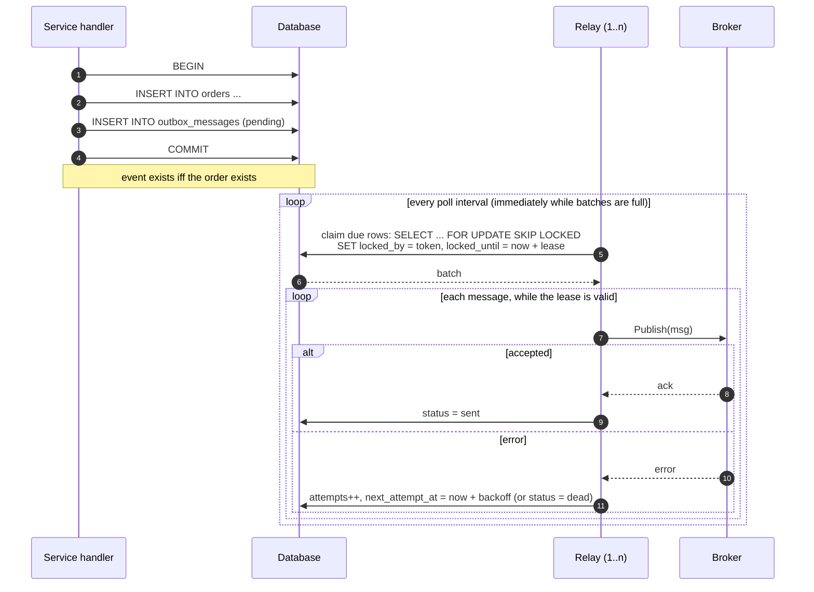

# go-outbox

[](https://github.com/neerajsinghi/go-outbox/actions/workflows/ci.yml)
[](https://pkg.go.dev/github.com/neerajsinghi/go-outbox)

**Transactional outbox and idempotency keys for Go microservices.** Built on
`database/sql` and the standard library, with PostgreSQL, MySQL and SQLite
support. No broker SDKs in the dependency tree.

- `outbox` writes events in **the same transaction** as your business change
  and relays them to Kafka, SQS, NATS or anything else afterwards.
- `idempotency` is `net/http` middleware for the `Idempotency-Key` header, so
  clients can retry `POST` requests without charging a card twice.

Together they cover both ends of a reliable request: the client can retry
safely into your service, and your service emits exactly the events for the
changes it committed.

## Why: the dual-write problem

A handler that saves an order and then publishes `OrderPlaced` is doing two
writes to two systems, and there is no transaction spanning both:

| Order of operations | Failure in between | Result |
| --- | --- | --- |
| commit, then publish | crash, broker timeout | order saved, **event lost** |
| publish, then commit | commit fails, deadlock | **event for an order that doesn't exist** |

The outbox removes the second write from the request path. The event is
inserted into an `outbox_messages` table inside the same database transaction
as the order, so either both exist or neither does. A relay then reads
committed rows and publishes them, retrying until the broker accepts.

## Features

- **Transactional enqueue**: `ob.Enqueue(ctx, tx, msg)` takes your `*sql.Tx`.
- **Dialects** for PostgreSQL, MySQL 8 and SQLite: placeholders, DDL, and
  `FOR UPDATE SKIP LOCKED` row claiming where the database supports it.
- **Relay** with batched polling, time-bounded **leases**, exponential
  **backoff with jitter**, a max-attempts **dead** state, `Permanent` errors,
  and **graceful shutdown** through `context`.
- **Horizontally scalable**: run as many relays as you like against one table.
- **Publisher interface** with in-memory and channel implementations for tests;
  Kafka and SQS adapters are a few lines (see below).
- **Idempotency middleware**: replays stored responses, `409` for in-flight
  duplicates, `422` for key reuse with a different body, TTLs, per-user scoping.
  Memory and SQL stores.
- **Operations helpers**: `Counts` for metrics, `PurgeSent`, `RetryDead`.

## Install

```sh
go get github.com/neerajsinghi/go-outbox
```

Requires Go 1.23+.

## Quickstart

```go
import (
	"github.com/neerajsinghi/go-outbox"
	"github.com/neerajsinghi/go-outbox/dialect"
)

ob, err := outbox.New(dialect.Postgres)
if err != nil { ... }

// Once, or copy ob.Schema() into your migrations.
if err := ob.CreateSchema(ctx, db); err != nil { ... }

// In your handler: business write + event, one transaction.
tx, err := db.BeginTx(ctx, nil)
if err != nil { ... }
defer tx.Rollback()

if _, err := tx.ExecContext(ctx, `INSERT INTO orders (id, total) VALUES ($1, $2)`, id, total); err != nil { ... }
if _, err := ob.Enqueue(ctx, tx, outbox.Message{
	Topic:   "orders.placed",
	Key:     id,                 // partition / ordering key
	Payload: payload,            // []byte, any encoding
	Headers: map[string]string{"content-type": "application/json"},
}); err != nil { ... }

if err := tx.Commit(); err != nil { ... }
```

Run the relay next to your service (or as its own deployment):

```go
relay := ob.NewRelay(db, kafkaPublisher,
	outbox.WithBatchSize(100),
	outbox.WithLease(30*time.Second),
	outbox.WithMaxAttempts(10),
	outbox.WithBackoff(outbox.ExponentialBackoff(time.Second, 5*time.Minute)),
)
go func() { _ = relay.Run(ctx) }() // returns when ctx is cancelled
```

Runnable examples (SQLite, no setup):

```sh
go run ./examples/relay     # orders + rollback + relay to stdout
go run ./examples/httpapi   # idempotent POST /payments on :8080
```

## How the relay works



- **Claiming.** PostgreSQL and MySQL select candidates with
  `FOR UPDATE SKIP LOCKED` and stamp them with a lease token, so concurrent
  relays take disjoint batches without blocking each other. SQLite, which has a
  single writer, claims with one atomic `UPDATE ... WHERE id IN (SELECT ...)`.
- **Leases.** A claimed row is invisible to other relays until `locked_until`.
  All state transitions are guarded by `locked_by = token`, so a relay whose
  lease was taken over cannot overwrite the new owner. A relay stops publishing
  a batch when its lease runs out instead of racing the next owner.
- **Retries.** Failures reschedule the message with `ExponentialBackoff`
  (doubling, capped, equal jitter). After `WithMaxAttempts` attempts, or on a
  `outbox.Permanent(err)`, the row moves to `dead` and `WithOnDead` fires.
  `ob.RetryDead` requeues dead rows once the cause is fixed.
- **Shutdown.** Cancelling the context lets the in-flight publish finish (bounded
  by `WithPublishTimeout`), records its outcome, and releases the rest of the
  batch immediately so another relay can pick it up. No attempt is burned.

## Delivery guarantees

**At-least-once.** Every committed message is published at least once; rolled
back messages are never published. A message can be published **more than
once**, e.g. when the broker accepted it but the relay crashed before marking it
sent, or a publish outlived its lease.

So **consumers must be idempotent**. `Message.ID` is a UUID that stays the same
across retries: store processed IDs (or use it as a dedupe key, e.g. SQS FIFO
`MessageDeduplicationId`) and skip repeats.

Ordering is by enqueue order within a batch, but retries and concurrent relays
mean there is no strict ordering guarantee, not even per key. Keep consumers
order-tolerant (for example, carry an aggregate version in the payload); a
strict per-key ordering mode is on the roadmap.

## Writing a Publisher

```go
type Publisher interface {
	Publish(ctx context.Context, msg outbox.Message) error
}
```

Return only after the broker durably accepted the message. Adapters live
outside the root module so it never pulls in broker SDKs.

<details>
<summary>Kafka (segmentio/kafka-go)</summary>

```go
type KafkaPublisher struct{ W *kafka.Writer } // RequiredAcks: kafka.RequireAll

func (p KafkaPublisher) Publish(ctx context.Context, m outbox.Message) error {
	hdrs := []kafka.Header{{Key: "outbox-id", Value: []byte(m.ID)}}
	for k, v := range m.Headers {
		hdrs = append(hdrs, kafka.Header{Key: k, Value: []byte(v)})
	}
	return p.W.WriteMessages(ctx, kafka.Message{
		Topic: m.Topic, Key: []byte(m.Key), Value: m.Payload, Headers: hdrs,
	})
}
```
</details>

<details>
<summary>Amazon SQS (aws-sdk-go-v2)</summary>

```go
type SQSPublisher struct {
	Client   *sqs.Client
	QueueURL func(topic string) string
}

func (p SQSPublisher) Publish(ctx context.Context, m outbox.Message) error {
	in := &sqs.SendMessageInput{
		QueueUrl:    aws.String(p.QueueURL(m.Topic)),
		MessageBody: aws.String(string(m.Payload)),
	}
	if m.Key != "" { // FIFO queue
		in.MessageGroupId = aws.String(m.Key)
		in.MessageDeduplicationId = aws.String(m.ID)
	}
	_, err := p.Client.SendMessage(ctx, in)
	return err
}
```
</details>

For tests, `publisher/memory` provides `Recorder` (records messages, optional
failure injection) and `Channel` (delivers to a Go channel with back-pressure).

## Idempotency keys

```go
import "github.com/neerajsinghi/go-outbox/idempotency"

store, _ := idempotency.NewSQLStore(db, dialect.Postgres) // or idempotency.NewMemoryStore()
_ = store.CreateSchema(ctx)

mw := idempotency.Middleware(store,
	idempotency.WithTTL(24*time.Hour),
	idempotency.WithScope(func(r *http.Request) string { return userID(r) }),
)
mux.Handle("POST /payments", mw(createPayment))
```

| Request | Response |
| --- | --- |
| new key | handler runs, response stored |
| same key, same method + path + body | stored response replayed, `Idempotent-Replayed: true` |
| same key while the first is still running | `409 Conflict` with `Retry-After` |
| same key, different body | `422 Unprocessable Entity` |
| handler returns 5xx or panics | not stored, key released so the client can retry |
| missing key | passes through (or `400` with `WithRequired()`) |

By default `POST` and `PATCH` are covered (`WithMethods` to change). In-flight
keys expire after `WithLockTimeout` (default 1 minute) so a crashed request does
not lock a key forever. Combine with the outbox inside the handler and a retried
request neither writes twice nor emits two events.

## Testing

```sh
go test -race ./...
```

Tests run against SQLite through the pure-Go `modernc.org/sqlite` driver, so
no database or cgo is needed. They cover rolled-back enqueues, publishing
exactly the committed rows, backoff to the dead state, lease expiry, concurrent
relays without double publishing, graceful shutdown, and idempotency
replay / 409 / 422 against both stores.

## Roadmap

- [ ] Integration test matrix against PostgreSQL and MySQL (testcontainers) in CI
- [ ] Kafka, SQS and NATS adapters as separate sub-modules
- [ ] `LISTEN/NOTIFY` wake-ups for PostgreSQL to cut polling latency
- [ ] OpenTelemetry trace propagation and metrics hooks
- [ ] Optional strict per-key ordering mode
- [ ] Batch publishing for brokers with batch APIs
- [ ] Partitioned / time-based cleanup helpers for very large tables

## License

[MIT](LICENSE) © 2026 Neeraj Singhi
